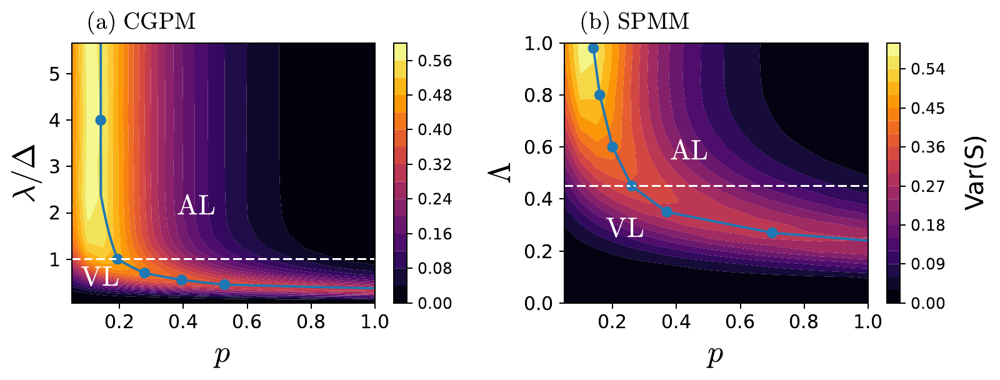
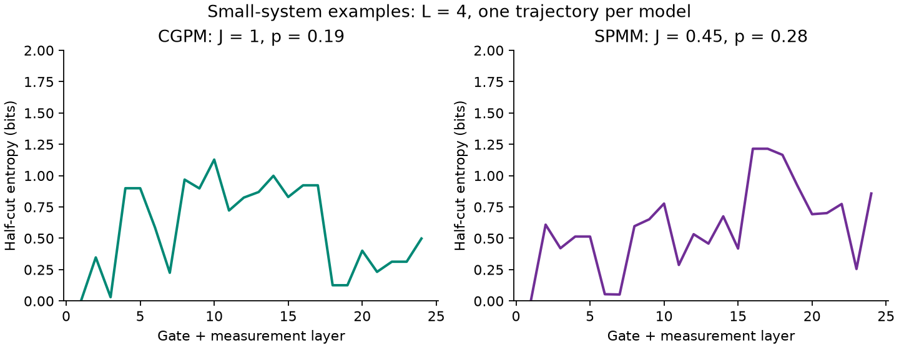
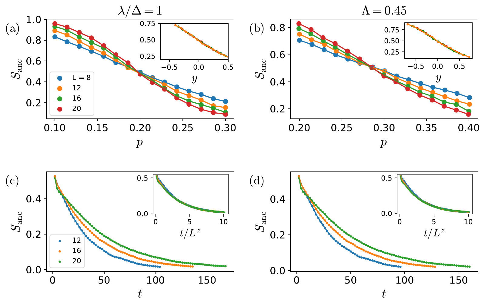
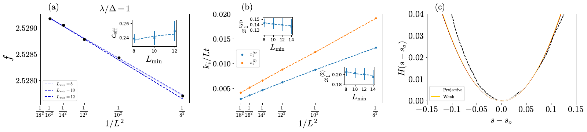
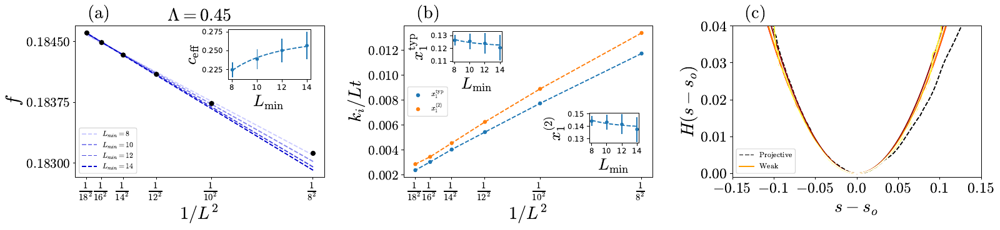

# Weak-Measurement-Induced Transitions

[](https://github.com/ka784-jpg/Weak-Measurement-MIPT/actions/workflows/tests.yml)
[](LICENSE)

Julia statevector simulations of monitored quantum circuits with weak measurements.
This repository preserves research scripts and supplies small, seeded
examples that call their original gate and measurement routines.

**Paper:** Kemal Aziz, Ahana Chakraborty, and J. H. Pixley,
[*Critical Properties of Weak Measurement Induced Phase Transitions in Random Quantum Circuits*](https://arxiv.org/abs/2404.02968v2),
Phys. Rev. B **110**, 064301 (2024).
[Published article](https://doi.org/10.1103/PhysRevB.110.064301).

[Run an example](#quickstart) | [Paper results](docs/RESULTS.md) | [Simulation interfaces](docs/CODE.md) | [Reproducibility](docs/REPRODUCIBILITY.md)



**What is being studied.** Random entangling gates compete with local, Born-rule
weak measurements. The paper compares continuous Gaussian pointers (CGPM),
discretized Gaussian pointers (DGPM), and softened projective measurements (SPMM).
This is the **published Figure 2**, not an output of the small example below.
[Figure explanation, original assets, and code mapping](docs/RESULTS.md).

## Quickstart

Install [Julia 1.12](https://julialang.org/downloads/) and clone this repository.
Run from the repository root:

```sh
julia --project=. -e 'using Pkg; Pkg.instantiate()'
julia --project=. --startup-file=no examples/quickstart.jl results/first-run
julia --project=. --startup-file=no tests/runtests.jl
```

The example evolves **one L=4 trajectory per model**, for 24 gate-plus-measurement
layers, using CGPM at J=1, p=0.19 and SPMM at J=0.45, p=0.28. It writes two CSV
traces and metadata recording the seed, Julia version, and source hashes.
It refuses to overwrite an existing output directory. First-time package
installation and compilation take longer than subsequent small runs.



To make this plot, using Python 3.12 or newer:

```sh
python -m pip install -r examples/requirements.txt
python examples/plot.py results/first-run results/first-run/trace.png
```

The [saved example outputs](examples/expected/) generated with Julia 1.12.6
are provided for inspection, not as a cross-platform bitwise guarantee.

## Explore the Results

| Ancilla probes, Fig. 3 | Gaussian log-CFT probes, Fig. 5 | Softened log-CFT probes, Fig. 6 |
| --- | --- | --- |
| [](docs/RESULTS.md#ancilla-probe-figure-3) | [](docs/RESULTS.md#gaussian-transfer-matrix-figure-5) | [](docs/RESULTS.md#softened-transfer-matrix-figure-6) |

## Scope and Limits

- Original sources are in [research/](research/). They are archived byte-for-byte,
  with descriptive filenames and a [hash manifest](docs/source_manifest.json).
- Supported examples use the original CGPM/SPMM kernels. A separate test also
  runs the DGPM Lyapunov driver at small size.
- The archive includes ancilla and correlation scripts, but not every archived
  batch entry point has been validated on the modern environment.
- Production datasets, exact historical seeds, and a complete end-to-end pipeline
  for every paper panel are **not** included. No full-paper reproduction is claimed.
- Exact statevectors cost memory exponential in L. The example deliberately
  caps L at 10. It is not an MPS or stabilizer approximation.
- Archived routines use mutable module state: the example API is serial and
  not thread-safe. Use separate processes for independent workers.

## Tests and Licensing

Tests cover gate unitarity and dual unitarity, dense gate application, measurement
limits, entropy bounds, seeded repeatability, a small DGPM trajectory, and refusal
to overwrite outputs. CI also checks archived-source and figure hashes and local links.

Code authored by Kemal Aziz and the added examples are under [MIT](LICENSE), with
the owner's authorization. Paper figures retain their separate
[CC BY 4.0 attribution](docs/figures/README.md); dependencies retain their licenses.
Please cite the paper when using these research methods.
